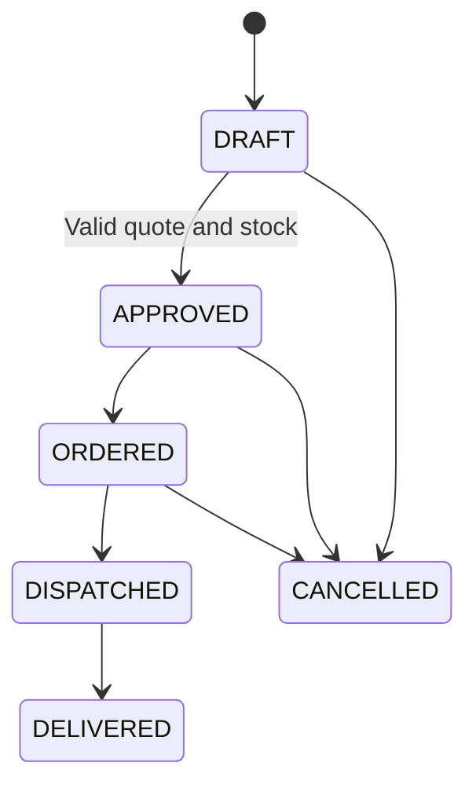

# Requirements and business process

## Problem and stakeholders

Scenario assumption: a fictional parts supplier receives ambiguous part requests and tracks quotations in separate messages. The goal is to make compatibility and stock decisions explicit before fulfilment. No actual stakeholder interviews or employer deployment are claimed.

| Stakeholder | Need | Validation question |
|---|---|---|
| Sales coordinator | Clear quotation totals and compatible parts | Can a wrong model be prevented? |
| Approver | Enforce discount and validity limits | Can an expired quote reserve stock? |
| Warehouse | Reliable available stock | Can two approvals oversell the same units? |
| Operations lead | Traceable status and exceptions | Can each transition be explained? |

## Prioritised requirements

| ID | Priority | Requirement | Acceptance criterion |
|---|---|---|---|
| P1 | Must | Match part to machine model | Incompatible pairs are rejected server-side |
| P2 | Must | Apply consistent money rules | 2 × ₹1,250, less 5%, plus ₹100 shipping, plus 18% demo tax = ₹2,920.50 |
| P3 | Must | Freeze quoted prices and enforce validity | Later catalogue price changes do not alter a quote; approval after day 7 is rejected |
| P4 | Must | Reserve available stock at approval | Competing approvals cannot reserve more than physical on-hand |
| P5 | Must | Control transitions and cancellation | No skipped states; cancellation before dispatch releases reservations |
| P6 | Must | Make retries safe | Identical creation retry returns one quote; changed request with same key rejects |
| P7 | Should | Preserve audit events | Draft, approval, order, dispatch and delivery have ordered UTC events |
| P8 | Must | Validate local API boundary | Invalid JSON, cross-origin mutations and unknown routes reject safely |
| P9 | Could | Support multi-line quotes and roles | Deferred to a stakeholder-reviewed next iteration |

## Stories and acceptance criteria

As a sales coordinator, I want part compatibility validated so the warehouse does not dispatch a part for the wrong machine.

Given a part belongs to SIM-A100, when SIM-B200 is supplied, then creation fails without creating a quote or changing stock.

As a warehouse user, I want approved quotes to reserve stock so another order cannot consume those units.

Given 12 available units and two competing requests for 8, when both are approved concurrently, then exactly one approval succeeds and reserved stock is 8.

As an operations lead, I want cancellation and dispatch to affect stock differently so figures retain a clear meaning.

Given an approved quote, cancellation releases the reservation without reducing physical stock. Given an ordered quote, dispatch reduces both reservation and physical stock exactly once.

## Risks and success measures

Compatibility is an exact fictional model match, not an engineering fit assessment. There is no replenishment process, shipment tracking or financial ledger. In a live pilot measure incompatible request rate, rework per quote, time to approve and reservation discrepancies against a recorded baseline. No percentage improvement is claimed from this demonstration.
